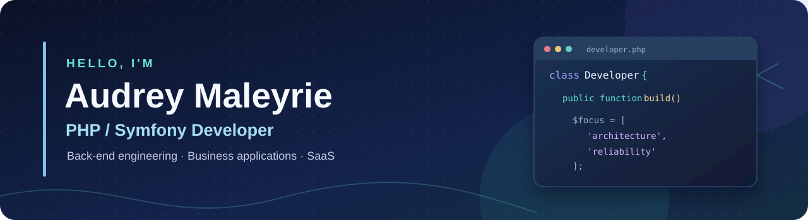

### Back-End Development · Software Architecture · AI & Automation

**Business applications · Multi-tenant SaaS · Agentic development workflows**

📍 Haute-Savoie, France · Geneva area

---

## About me

I'm a **PHP / Symfony developer** focused on back-end engineering and business applications. I enjoy translating complex business needs into secure, maintainable software.

I also work with **LLM-assisted development, coding agents, agent harnesses, and automation workflows**, combining software engineering practices with practical AI tooling.

My featured work includes a fully functional tournament management platform and a multi-tenant expense management SaaS preparing for its first company pilot.

---

## Software Engineering

### Back-end & databases

### Front-end & web

### Architecture, quality & DevOps

I focus on **domain modeling, access control, workflow consistency, financial data integrity, automated tests, and maintainable application architecture**.

---

## AI Engineering & Automation

### LLMs, AI agents & agent harnesses

I use coding agents and agent harnesses as part of my development workflow: project instructions, context management, tool integration through MCP, and controlled agent-assisted implementation.

### Automation & knowledge management

I design connected workflows using automation platforms, APIs and webhooks, and organize knowledge across tools such as Notion and Obsidian.

*The technologies shown reflect different levels of experience across professional projects, personal development, automations, and ongoing learning. They do not all indicate the same level of expertise.*

---

## Featured projects

<table>
<tr>
<td width="50%" valign="top">

### Tournament Management Platform

**PHP · Symfony · Doctrine ORM · Messenger**

A fully functional web platform developed for Annecy Volleyball.

- Registrations, payments and teams
- Competition management, scores and rankings
- Volunteer coordination and documents
- Concurrency and data protection

**My role:** Lead contributor since 2021. The scheduling algorithm was primarily designed and developed by another contributor.

[**Explore the project →**](https://github.com/Noa83/tournament-management-showcase)

</td>
<td width="50%" valign="top">

### Expense Management SaaS

**PHP 8.4 · Symfony 7.4 · PostgreSQL**

A multi-tenant application for company expense management.

- Expense reports and mileage claims
- Approval and reimbursement workflows
- Company data isolation and permissions
- 2FA, background jobs, tests and CI

**Status:** Active development; first pilot within a company in preparation.

[**Explore the project →**](https://github.com/Noa83/expense-management-showcase)

</td>
</tr>
</table>

### Custom Jewellery Pricing

**PHP · WordPress · WooCommerce · MySQL · JavaScript · AJAX**

A custom WooCommerce plugin designed to automate complex jewellery pricing through configurable business formulas and product variation management.

**Highlights**

- Global and product-specific pricing formulas.
- Material-based calculations, including gold, silver and palladium-containing gold.
- Pricing based on weight, labour costs and optional components.
- Bulk price recalculation across products containing **up to 4,500+ variations each**.
- Error logging, missing-data detection and performance diagnostics.
- Optimized database operations for large-scale price updates.

**My role:** Custom plugin development and implementation of business-specific pricing logic.

**[Explore the project →](https://github.com/Noa83/custom-jewellery-pricing-showcase)**

> These repositories are public technical case studies. The application source code remains private.

---

## GitHub contributions

*This static, recolored contribution calendar relies on an external service and the contribution information GitHub makes available. GitHub's native activity graph remains below the profile README; its green color cannot be customized using README Markdown. Private contributions appear only to the extent allowed by GitHub visibility settings.*

---

## En français 🇫🇷

**Développeuse PHP / Symfony confirmée**, spécialisée dans le développement back-end, l'architecture d'applications métier, la sécurité et les workflows.

Je travaille également sur les **LLM, agents de développement, harnais d'agents et automatisations**, notamment avec **n8n et Make**.

📍 Basée en Haute-Savoie, à proximité de Genève.

**Mes projets :**

- [Gestion de tournois sportifs](https://github.com/Noa83/tournament-management-showcase) — Application Symfony pour plus de 550 équipes et environ 1 800 joueurs.
- [SaaS de gestion des notes de frais](https://github.com/Noa83/expense-management-showcase) — Plateforme multi-entreprises, premier pilote en préparation.
- [Moteur de tarification pour bijoux](https://github.com/Noa83/custom-jewellery-pricing-showcase) — Plugin WooCommerce gérant des calculs de prix sur des produits pouvant dépasser 4 500 variations.

